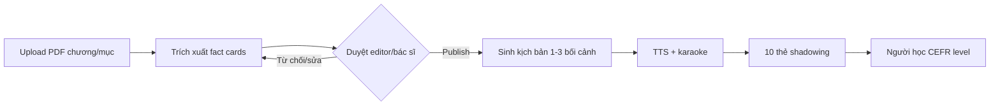
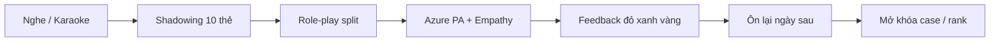

# Brief: Nền tảng học tiếng Anh giao tiếp y khoa (Medical English)

**Project:** LearnEnglish  
**Phiên bản brief:** 1.2  
**Ngày:** 2026-11-15  
**Trạng thái:** Đã chốt phỏng vấn + đề xuất stack (Gemini) — sẵn sàng triển khai trong Cursor

---

## 1. Tầm nhìn

Xây dựng **nền tảng web** giúp **bác sĩ nội trú** luyện **tiếng Anh giao tiếp y khoa** từ **tài liệu chính thống** (khởi đầu: *Nelson Textbook of Pediatrics*), với pipeline: upload PDF → trích xuất tri thức có truy vết → sinh hội thoại song ngữ → audio karaoke + shadowing.

**Nguyên tắc nội dung:** AI **không suy diễn** ngoài sách; nội dung mơ hồ được **bỏ qua** hoặc gắn nhãn **cần xác minh**; **bác sĩ/editor duyệt trước khi publish**.

**Kỹ thuật & quy trình:** Phụ thuộc **Cursor** và quy trình BMAD đã tích hợp trong repo `learn-english` (spec → triển khai trong môi trường dev).

---

## 2. Người dùng & mục tiêu học

| Hạng mục | Mô tả |
|----------|--------|
| **Đối tượng chính** | Bác sĩ nội trú |
| **Trình độ** | Người học chọn **1 trong 3 level** theo khung **CEFR** (tham chiếu A1–C2); sản phẩm map 3 gói: sơ / trung / cao (chi tiết map trong thiết kế) |
| **Kỹ năng** | **Nghe – nói – đọc thuật ngữ** (cân bằng, không chỉ hội thoại) |
| **Đơn vị học** | **Một ca lâm sàng** tách từ nội dung **chương/mục** sách |
| **Lộ trình** | **6 tháng**, người học **tự chọn số bài/tuần** |
| **Chứng chỉ / điểm** | Chưa trong phạm vi; có thể bổ sung sau |

### 2.1 CEFR ảnh hưởng nội dung

Với mỗi level, hệ thống điều chỉnh:

- **Từ vựng & cấu trúc câu** (độ khó)
- **Độ dài** đoạn thoại / clip
- **Mức formal**: ví dụ **A2** — đơn giản, đời thường hơn; **C1** — học thuật, formal hơn (đặc biệt bối cảnh chuyên gia/CME)

---

## 3. Nguồn tài liệu & pháp lý

- PDF **hợp pháp, dùng công khai** theo quyền của tổ chức/người dùng.
- **MVP / giai đoạn 1:** *Nelson Textbook of Pediatrics*.
- **Mở rộng sau:** Harriet Lane, WHO, guideline, v.v. (kiến trúc đa nguồn, chưa bắt buộc nhập liệu ở MVP).
- **Metadata bắt buộc** trên mọi đoạn trích / fact: **ISBN, edition, số trang**, (và khi có: mục/chương) — phục vụ **watermark / truy vết** và hiển thị cho người học.

**Ngôn ngữ nguồn:** Tiếng **Anh**. **Tùy chọn** đối chiếu bản dịch **Việt** (toggle, không thay thế nguồn gốc).

---

## 4. Pipeline chức năng (end-to-end)



### 4.1 Upload

- Người dùng có quyền phù hợp upload file PDF (phạm vi: chương hoặc phần đã thống nhất kỹ thuật).
- Lưu file trên **cloud** (ưu tiên **Google Cloud** — Storage + có thể **Cloud SQL** cho metadata/quan hệ; region theo cấu hình GCP).

### 4.2 Trích xuất tri thức — Clinical fact cards

**Định dạng output (đã chốt):**

Mỗi **thẻ fact lâm sàng** gồm:

| Trường | Mô tả |
|--------|--------|
| `source_quote` | Trích nguyên văn ngắn hoặc bullet **bám sát** câu gốc trong PDF |
| `metadata` | ISBN, edition, trang, chương/mục |
| `atomic_fact` | Một mệnh đề nguyên tử (triệu chứng, chẩn đoán, xử trí, chống chỉ định, v.v.) |
| `category` | Nhãn phân loại (tối thiểu: loại fact; mở rộng sau) |
| `status` | `verified` (sau duyệt) \| `needs_review` \| loại bỏ nếu mơ hồ |

**Quy tắc:**

- Không thêm suy luận lâm sàng không có trong nguồn.
- PDF **mơ hồ/thiếu:** **bỏ qua** hoặc đánh dấu **`needs_review`** — không đưa vào dialogue publish.
- Mọi câu trong kịch bản đã publish phải **liên kết** ≥ 1 fact card đã duyệt (traceability).

### 4.3 Duyệt nội dung (human-in-the-loop)

- **Trước publish:** editor/bác sĩ review fact cards và (khi cần) preview dialogue.
- **Editor:** **người dùng bình thường** có quyền editor (không chỉ admin); admin quản trị hệ thống.

### 4.4 Sinh kịch bản — ba bối cảnh

Với **mỗi ca lâm sàng**, người dùng chọn sinh:

- **1 trong 3**, hoặc **cả ba** (tạo tương ứng 1–3 clip/bài).

| # | Bối cảnh | Mô tả | Giọng / register |
|---|----------|--------|------------------|
| 1 | **Bệnh nhân / thân nhân** | Trẻ **>10 tuổi** tự trao đổi hoặc thân nhân nhi; hỏi bệnh, thăm khám, giải thích | Đời thường |
| 2 | **Đồng nghiệp** | Round, visit, hội chẩn, thủ thuật; trao đổi chuyên môn | Đời thường + thuật ngữ học thuật |
| 2b | **SBAR** (trong nhóm đồng nghiệp) | Template **SBAR cố định**: Situation – Background – Assessment – Recommendation | Chuẩn bàn giao |
| 3 | **Chuyên gia / học viên** | Trình bày, thảo luận, Q&A case/bệnh học, báo cáo khoa học, CME | **Formal** hơn |

**Độ dài (MVP):** ~**2 phút** mỗi kịch bản.

**Mở rộng sau MVP:** phiên **~10 phút** (kiểu thuyết trình/bài giảng).

**Song ngữ:** Có **bật/tắt** tiếng Việt; **chủ đạo tiếng Anh**.

### 4.5 Audio, karaoke, shadowing

| Tính năng | MVP | Sau MVP |
|-----------|-----|---------|
| **TTS** | ElevenLabs, Google, Azure, hoặc OpenAI (chọn theo chi phí/chất lượng) | Giọng thật / studio |
| **Demo giọng** | Bác sĩ **nam**; thân nhân **nữ**; đồng nghiệp **nam** | Nhiều lựa chọn giọng (nam/nữ, accent) |
| **Hai vai** | Một giọng **chuẩn** (bác sĩ/chuyên gia) + một giọng **“bệnh nhân địa phương”** (theo vai) | Mở rộng catalog |
| **Karaoke** | Highlight theo **từ** (word); tốc độ **0.5×–1.25×** | — |
| **Shadowing** | **10 thẻ** cuối bài: câu ngắn từ dialogue, **collocation**, câu **SBAR** mẫu | — |
| **Chấm phát âm / role-play** | **Nền tảng:** ghi âm (RecordRTC/Web Speech), lưu `Attempt` | **Azure Pronunciation Assessment** + empathy LLM + SRS (mục 11–12) |

### 4.6 Nền tảng

- **Hiện tại:** **Web app** (repo/project **learn-english**).
- **Sau:** Ứng dụng **mobile**.
- **Đăng nhập:** Cá nhân; **Google account**; vai trò **admin / editor / learner**.

---

## 5. Phạm vi MVP — 90 ngày (Lựa chọn **B**)

**Mục tiêu:** Sản phẩm **dùng được thật** trong ~3 tháng — đủ ba bối cảnh, chưa phải đầy đủ “tầm nhìn dài”.

### 5.1 Trong MVP

- Upload PDF (Nelson) + lưu cloud GCP.
- Trích xuất **clinical fact cards** + metadata ISBN/trang/edition.
- Luồng **duyệt** trước publish (editor = user thường được cấp quyền).
- **Một ca lâm sàng** → user chọn **1–3** bối cảnh → sinh kịch bản **~2 phút** mỗi loại đã chọn.
- **Ba bối cảnh** đầy đủ (bệnh nhân/thân nhân, đồng nghiệp **+ SBAR**, chuyên gia/CME-style).
- **3 level CEFR** (độ khó từ/câu, độ dài, formal).
- Toggle **Việt**; karaoke + **10 thẻ shadowing**.
- TTS **2 giọng demo** (theo mục 4.5).
- **Lộ trình 6 tháng** + **số bài/tuần** tự chọn (cấu hình người học).
- Đăng nhập Google + phân quyền admin/editor/learner.
- **Hạ tầng học (chỉ nền, không chấm điểm đầy đủ):** schema `LearningAttempt`, API upload audio, màn role-play **placeholder** (split view + giữ micro) — dữ liệu sẵn sàng cho Pha 2.

### 5.2 Pha 2 — Vòng học, chấm điểm, gamification (sau MVP B ~90 ngày)

- **Azure AI Speech — Pronunciation Assessment** (accuracy, prosody, missing words).
- **AI Scoring đa chiều:** Accuracy thuật ngữ; **Empathy** (LLM) khi trả lời tự do (role-play).
- **Visual feedback** đỏ / xanh / vàng; chạm từ sai → nghe lại AI.
- **Stress y khoa** (ví dụ *e-lec-tro-**car**-dio-gram*) và **ngữ điệu lâm sàng** (ưu tiên level cao; level cơ bản: nói–nghe–hiểu).
- **SRS:** cụm phát âm sai → *Thẻ cần ôn lại* ngày hôm sau.
- **Gamification:** mở khóa **case hiếm/chuyên sâu** (không phần thưởng trang trí); **danh hiệu**; **CME ảo** + chứng nhận số; **cây chuyên khoa** (module đại cương → tim mạch nhi…).

### 5.3 Ngoài Pha 2 (roadmap)

- Clip **10 phút** (thuyết trình).
- Xuất **video MP4** qua Remotion (mục 10.4).
- Đa sách (Harriet Lane, WHO, guideline…).
- App mobile; giọng studio; **ElevenLabs** TTS premium.
- Chi tiết **ngân sách** scale (Azure Speech metering) — xem mục 6.

---

## 6. Chi phí & hạ tầng (hướng)

- **Ưu tiên:** Tầng **free / giá thấp** cho OCR, LLM, TTS khi có thể; đo lường khi scale.
- **Pha 2:** **Azure Speech** (Pronunciation Assessment) — tính phí theo phút audio; cache mẫu chuẩn; giới hạn retry.
- **Lưu trữ / DB:** **Google Cloud** (Storage + **Cloud SQL** nếu phù hợp schema).
- **Yêu cầu data residency VN:** *Chưa chốt* — ghi nhận khi triển khai production.

---

## 7. Tiêu chí thành công (đề xuất cho giai đoạn sau brief)

- Editor có thể publish **một ca** từ Nelson với fact có truy vết đầy đủ trong &lt; SLA nội bộ (định nghĩa khi thiết kế).
- Resident hoàn thành **≥1 bài/tuần** (tự chọn) với **3 bối cảnh** và shadowing.
- Không có báo cáo nội dung **không khớp trích dẫn** sau audit mẫu.

*(Chứng chỉ/điểm: TBD theo yêu cầu sau.)*

---

## 8. Rủi ro & giả định

| Rủi ro | Giảm thiểu |
|--------|------------|
| Hallucination LLM | Fact cards + bắt buộc liên kết nguồn; duyệt người; prompt/RAG cứng |
| Bản quyền PDF | Chỉ upload có quyền; metadata; không phân phối PDF raw cho learner nếu không được phép |
| Chi phí TTS/LLM | Cache audio; giới hạn độ dài MVP 2 phút; free tier |
| Chất lượng OCR sách y khoa | Pipeline OCR + kiểm tra editor |

**Giả định:** Người học có trình độ nền y khoa; nền tảng không thay thế đào tạo lâm sàng chính thức.

---

## 9. Bước tiếp theo (sau brief)

1. Định nghĩa schema JSON (fact cards, dialogue lines, timestamps) trong `.cursorrules` hoặc `schemas/`.
2. Scaffold **backend/** + **frontend/** theo mục 10 (Cursor Agent / Composer).
3. UX luồng: upload → fact review → chọn 1–3 bối cảnh + CEFR → player → shadowing.
4. Implementation plan (BMAD / writing-plans) và milestone 90 ngày (MVP B).

---

## 10. Đề xuất kiến trúc & lộ trình code (tham khảo Gemini)

Phần này **bổ sung** brief nghiệp vụ, không thay quy tắc: vẫn **fact cards**, **duyệt editor**, **metadata ISBN/trang**, **3 bối cảnh**, **CEFR**. Stack ưu tiên **chi phí thấp** cho MVP; nâng cấp provider sau.

### 10.1 Cấu trúc monorepo (đề xuất)

```text
learn-english/
  backend/          # FastAPI
  frontend/         # Vite + React + TypeScript + Tailwind
  schemas/          # JSON Schema dùng chung (LLM structured output + API)
  .cursorrules      # Tham chiếu schema, không suy diễn
```

**Hạ tầng:** Google Cloud Storage (PDF, MP3), Cloud SQL (metadata, cases, review state), xác thực Google OAuth.

### 10.2 Bước 2 — Backend: bóc Nelson & sinh kịch bản (Python / FastAPI)

| Module | Trách nhiệm | Ghi chú brief |
|--------|-------------|----------------|
| `pdf_parser.py` | **Docling** đọc PDF y khoa; text sạch theo heading (*Clinical Manifestations*, *Diagnosis*, *Treatment*, …) | Kết hợp pipeline **clinical fact cards** (mục 4.2), không chỉ text thô |
| `script_generator.py` | **google-genai** (`gemini-2.5-pro`), **Structured Outputs** đúng schema JSON | Input: fact cards **đã duyệt**; 3 **system prompt** cho 3 bối cảnh: (a) bệnh nhân/thân nhân layman, (b) đồng nghiệp **SBAR**, (c) chuyên gia/CME formal; điều chỉnh theo **CEFR** |
| `tts_engine.py` | **edge-tts** — MP3 từng câu; `timestamps.json` (WordBoundary, ms) cho karaoke | **MVP mặc định** (free); demo: `en-US-GuyNeural` (bác sĩ/đồng nghiệp nam), `en-US-JennyNeural` (thân nhân nữ). Sau: ElevenLabs / Google / Azure |

**API gợi ý:** `POST /cases/upload`, `POST /cases/{id}/extract`, `PATCH /facts/{id}/review`, `POST /cases/{id}/generate-dialogues`, `POST /cases/{id}/synthesize-audio`.

**Luồng bắt buộc:** `extract` → facts `needs_review` → editor publish → mới gọi `generate-dialogues` (tránh sinh kịch bản từ nội dung chưa duyệt).

### 10.3 Bước 3 — Frontend: Karaoke & Shadowing (React + TypeScript)

| Màn hình | Chức năng | Khớp MVP B |
|----------|-----------|------------|
| **Upload & Config Studio** | Upload PDF; chọn **1–3** bối cảnh; **CEFR**; toggle Việt; nút *Tạo bài học* | Có |
| **Interactive Karaoke Player** | Scene phòng khám; highlight người nói; phụ đề EN (+ VI); highlight từ theo `timestamps.json` (màu vai: ví dụ teal bác sĩ, cam bệnh nhân) | Có |
| **Shadowing Flashcard Grid** | Lưới **10 thẻ** (2 cột), `is_key_phrase: true`; luyện đuổi tự động / bấm từng thẻ | Có |
| Thu âm | **RecordRTC** / Web Speech API → backend `POST /attempts/audio` | MVP: lưu file; **Pha 2:** gửi Azure PA |
| Role-play split screen | AI vai bệnh nhân/đồng nghiệp; giữ micro nói lượt mình | UI MVP; chấm đầy đủ Pha 2 |

### 10.4 Bước 4 — Xuất MP4 (Remotion) — **ngoài MVP B**

- **Remotion** tái dùng component Karaoke + Shadowing thành `<Composition>`.
- Backend: `POST /api/export-video` gọi `npx remotion render` → MP4 1080p.
- Dùng khi cần chia sẻ clip như mẫu Facebook / kênh học thuật; không blocking MVP 90 ngày.

### 10.5 Đối chiếu Gemini ↔ quyết định sản phẩm

| Gemini | Brief | Quyết định |
|--------|-------|------------|
| 3 bối cảnh trong prompt | Hỏi bệnh, đồng nghiệp+SBAR, chuyên gia/CME | Giữ; user chọn 1–3 |
| Structured JSON | Fact cards + traceability | Schema gồm cả `facts` và `dialogue` |
| edge-tts | Đã liệt kê ElevenLabs, Google… | **MVP: edge-tts**; premium TTS sau |
| Remotion export | Chưa trong MVP | **Roadmap** sau MVP B |
| Chỉ Composer prompt | BMAD + Cursor | Dùng Agent/Composer triển khai theo brief này |

### 10.6 Gợi ý lệnh Composer (tham khảo)

Triển khai trong Cursor (**Agent**), tách hai pass: backend trước, frontend sau. Nội dung lệnh = mục 10.2–10.3; thêm yêu cầu **fact-card review gate** và **schema** trong repo.

*(Giữ nguyên câu chữ prompt gốc của Gemini trong chat triển khai; brief chỉ mô tả yêu cầu kỹ thuật.)*

### 10.7 Backend bổ sung (Pha 2)

| Module | Công nghệ | Ghi chú |
|--------|-----------|---------|
| `pronunciation_assessment.py` | **Azure AI Speech** Pronunciation Assessment (Python SDK) | Điểm phoneme/syllable, prosody, completeness; map vào UI đỏ/xanh/vàng |
| `empathy_scorer.py` | **Gemini** (structured rubric) | Chỉ khi `response_mode=free_speech` (không đọc script cố định) |
| `srs_scheduler.py` | Cloud SQL + cron | Thẻ ôn lại từ `weak_phrases` (sai / ngập) — **ngày T+1** |
| `progression_service.py` | SQL | Rank, CME ảo, unlock case, specialty tree state |

**Metadata thuật ngữ:** trong fact/dialogue, optional `stress_pattern` (ví dụ `[3,1,1,**2**,1,1]`) và `key_phrase` để PA và karaoke nhấn đúng âm.

---

## 11. Vòng học tương tác (The Learning Loop)



### 11.1 Phát âm & giao tiếp lâm sàng

| Tầng CEFR | Trọng tâm |
|-----------|-----------|
| **Cơ bản (A2–B1)** | Nghe–nói–hiểu; giao tiếp được; phát âm từ đúng là đủ |
| **Cao (B2–C1)** | **Trọng âm thuật ngữ y khoa** (ví dụ *electro**car**diogram*); **ngữ điệu** (trầm ấm, đồng cảm khi báo tin xấu cho thân nhân nhi) |

Nội dung sinh kịch bản và mẫu TTS phải phản ánh level đã chọn (prompt + tagging `cefr_level`).

### 11.2 Shadowing & spaced repetition

- Sau mỗi lượt shadowing/role-play, hệ thống ghi nhận từ/cụm **sai** hoặc **ấp úng** (từ Azure PA).
- Tự động đưa vào hàng đợi **「Thẻ Flashcard cần ôn lại」** — hiển thị **ngày hôm sau** (SRS đơn giản: T+1, sau đó mở rộng SM-2 nếu cần).

### 11.3 Role-play (đóng vai)

- Trình duyệt **chia đôi**: một bên avatar/script AI (bệnh nhân / đồng nghiệp), một bên **bác sĩ giữ micro** nói lượt của mình.
- Hai chế độ:
  - **Read-along:** so khớp script (chủ yếu **Accuracy** + stress).
  - **Free response:** trả lời tự do → thêm **Empathy** (LLM đánh giá lịch sự, trấn an).

### 11.4 AI scoring đa chiều

| Chiều | Cách đo | UI |
|-------|---------|-----|
| **Accuracy** | Azure PA vs reference text + thuật ngữ y khoa | Từ đúng: xanh; sai: đỏ; ngập: vàng |
| **Empathy** | LLM rubric (chỉ free response) | Nhãn + gợi ý câu mẫu |
| **Prosody / stress** | Azure prosody + `stress_pattern` metadata | Gợi ý nhấn âm trên từ dài |

**Tương tác:** chạm từ **đỏ** → phát lại clip **giọng chuẩn AI** (edge-tts/Azure) cho từ/cụm đó.

---

## 12. Gamification — động lực học (không cosmetic)

**Nguyên tắc:** Phần thưởng = **quyền học sâu hơn**, không skin/avatar kiểu “kim cương mua áo”.

### 12.1 Mở khóa nội dung (Progression unlocks)

- Ví dụ: hoàn thành **chuỗi 7 ngày** module *Tim bẩm sinh cơ bản* → mở khóa case **Báo cáo can thiệp đóng VSD phức tạp**.
- Case **hiếm / chuyên sâu** gắn điều kiện: prerequisite module, điểm CME tối thiểu, hoặc rank.

### 12.2 Danh hiệu (Rank / Titles)

Lộ trình gợi ý:

`Medical Student` → `Intern` → `Resident` → `Attending Physician` → `Chief of Staff`

Điều kiện lên hạng: số case hoàn thành, điểm PA trung bình (ngưỡng theo rank), hoàn thành module bắt buộc.

### 12.3 CME ảo & chứng nhận số

- Mỗi case hoàn thành (đã qua karaoke + shadowing + tối thiểu một lượt role-play đạt ngưỡng) → **CME points ảo**.
- Đủ điểm module → **Digital Certificate** (PDF/OG image) chia sẻ LinkedIn / Facebook.
- *Disclaimer:* CME ảo **không thay** CME được cấp phép chính thức — ghi rõ trên chứng nhận.

### 12.4 Cây chuyên khoa (Sub-specialty trees)

- Hoàn thành **Nhi khoa đại cương** (Sốt, Tiêu chảy, Hô hấp…) → mở nhánh **Tim mạch nhi** (PDA, siêu âm tim, can thiệp…).
- Cấu trúc: `Module` → `Case` → `Prerequisite`; map với fact cards / chương Nelson tương ứng.

---

## 13. Lộ trình triển khai tính năng học — khuyến nghị

| Thứ tự | Giai đoạn | Lý do |
|--------|-----------|--------|
| **1** | MVP B: pipeline PDF → dialogue → karaoke → shadowing | Giá trị cốt lõi; content có truy vết |
| **2** | Cùng repo: **ghi âm + Attempt schema + role-play UI** | Không phụ thuộc Azure ngay; validate UX |
| **3** | **Pha 2:** Azure PA + feedback màu + SRS T+1 | “Tiêu chuẩn vàng” chấm phát âm |
| **4** | Empathy LLM + unlock case + rank + CME cert | Cần dữ liệu học ổn định từ bước 3 |

**Không khuyến nghị** xây full gamification + empathy **trước** khi có case publish ổn định — dễ tốn chi phí API và sửa UX lặp.

---

## Phụ lục — Tóm tắt quyết định phỏng vấn

| Chủ đề | Quyết định |
|--------|------------|
| Output trích xuất | Clinical fact cards + metadata |
| MVP | **B** — pipeline + karaoke + shadowing; **nền** ghi âm/role-play; **chấm điểm đầy đủ = Pha 2** |
| Ca lâm sàng | User chọn **1–3** kịch bản để sinh clip |
| Editor | User bình thường (role editor) |
| Cloud | Google Cloud (Storage / SQL) |
| CEFR | Từ vựng, độ dài, formal (A2 đơn giản → C1 học thuật) |
| Stack MVP | FastAPI + Docling + Gemini structured + edge-tts; Vite/React/Tailwind |
| Stack Pha 2 | Azure Pronunciation Assessment; RecordRTC; SRS; progression DB |
| Stack sau MVP | Remotion MP4; ElevenLabs TTS premium |
| Gamification | Unlock case + rank + CME ảo + specialty tree (không cosmetic) |